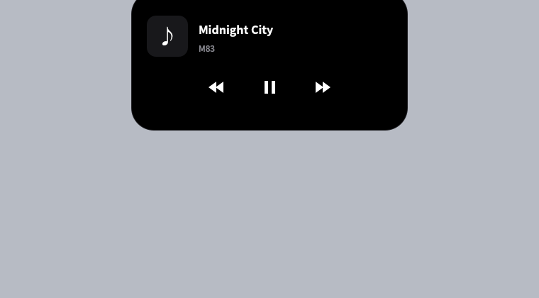

# Love Island

KDE Plasma Wayland 上的实验性灵动岛通知界面。黑色胶囊贴合屏幕顶部，悬停展开，移开收起，集成媒体控制、音量亮度反馈和通知历史。

基于 [teodorgross/Dynamic-Island-Plasma-Wayland](https://github.com/teodorgross/Dynamic-Island-Plasma-Wayland) 的 MIT 项目，保留上游 MIT 许可证和版权。本独立仓库基于上游 v1.0.1 / `50dec690461fb1519f349a85ba62c8e503228992` 开始定制，当前版本为 **0.1.0**。

[English installation](docs/INSTALL.en.md) · [架构](docs/island-architecture.md) · [性能记录](docs/island-performance.md) · [更新记录](CHANGELOG.md)



## 能做什么

- 空闲时保留胶囊，悬停打开历史；播放音乐时常驻歌曲信息，悬停展开上一首、暂停和下一首。
- 接管 `org.freedesktop.Notifications`；FIFO 排队，仅当前通知倒计时，悬停暂停。支持应用提供的通知操作。
- 音量和亮度短暂抢占，之后恢复；接电提示、KDE 勿扰联动、全屏与锁屏隐藏、主屏跟随。
- 右键将活动消息归入历史并打开通知中心；历史可清空和打开来源应用。
- 默认覆盖顶部面板中间区域，不改变面板布局，不为窗口另占一行空间。

## 支持范围与已知限制

主要在 **CachyOS / Arch Linux、KDE Plasma Wayland** 上验证；开发环境为 Plasma 6.8.1、Qt/PySide6 6.12.0。其他发行版和 X11 未验收。使用发行版提供的 Qt/PySide6，避免 PyPI Qt 与 KDE 插件版本混用。

**尚未实现稳定 144 FPS。** 动画仍有长帧；不能把屏幕刷新率或属性更新频率当作实际帧率。展开宽/高为 340/300ms，收起为 450/430ms。完整测量口径见性能记录。

播放器须支持 MPRIS。历史不保留已关闭通知的操作按钮或内联回复；动态音柱不是音频频谱。文件复制进度保留 KDE 默认界面。物理插拔屏幕、电源及重新登录仍需更多实机验证。上游的独立设置面板、额外源和旧演示素材不作为本版已支持功能。

## 安装

AUR 目标包名为 `love-island`。**只有在 AUR 页面实际存在后才可使用 `paru -S love-island`；仓库包含打包文件不代表已经提交 AUR。**

从本仓库的 v0.1.0 标签本地打包：

```bash
git clone https://github.com/yucben/love-island.git
cd love-island
git checkout v0.1.0
cd packaging/aur
makepkg -si
```

安装会为可识别的安装发起账户启用灵动岛：当前已登录本地 Plasma Wayland 时立即接管通知，以后登录自动启动。首次接管会重启 Plasma shell，面板可能短暂重载。优先识别 `SUDO_UID`，否则仅在存在一个活动本地 KDE Wayland 账户时选用；多账户或无桌面会话时不猜测账户。无法自动启用时，在目标用户的终端执行：

```bash
love-island-session start
```

软件包提供恢复入口，卸载时也会尝试恢复 KDE 通知，不删除个人配置和历史。安装后自动运行的范围和异常回退见 [打包说明](packaging/README.md)。

不安装系统包也可从源码部署到当前用户目录：

```bash
sudo pacman -S --needed pyside6 python-dbus python-gobject layer-shell-qt plasma-workspace kwin libkscreen kconfig glib2 ripgrep
bash tools/session.sh install
```

此方式使用 `~/.local/bin/island-session` 管理，不和 AUR 版同时运行。AUR 版首次启动会停用旧源码服务；不会删除旧源码安装备份。

## 启用、停用与恢复

```bash
love-island-session status
love-island-session restore   # 立即恢复 KDE 通知，后续登录保持停用
love-island-session start     # 再次启用并恢复自启
```

应用菜单中也有 Love Island 和“恢复 KDE 默认通知”。系统包版本的用户服务为 `love-island.service`，日志用 `journalctl --user -u love-island.service` 查看。

为了兼容已有用户，配置与历史目录继续沿用 `dynamic-island`：

- 配置：`~/.config/dynamic-island/config.json`
- 历史：`~/.local/share/dynamic-island/`
- 原始 OSD 状态、停用标记与备份：`~/.local/state/dynamic-island/`

支持 XDG 对应目录变量。不要将通知历史、个人配置或密钥提交到仓库。日志和截图通过用户会话接口访问；演示图为隔离测试生成。

## 开发与验证

Python + PySide6 / QML；C++ 仅用于诊断，不是运行依赖。

```bash
PYTHONPATH=src /usr/bin/python -m unittest discover -s tests -v
bash -n tools/session.sh
```

离屏测试使用独立配置与历史，不接管当前桌面通知。CI 在独立 D-Bus 会话中运行；原生会话检查和帧率测量见 [diagnostics](diagnostics/README.md)。旧上游安装器和设置面板不包含在发布目录中。

## 许可证与致谢

[MIT](LICENSE)，保留原作者 Teodor Gross 的版权。感谢上游项目及 Qt、KDE Plasma、layer-shell-qt 的开发者。Love Island 是独立开源项目，与 Apple 无关联。
